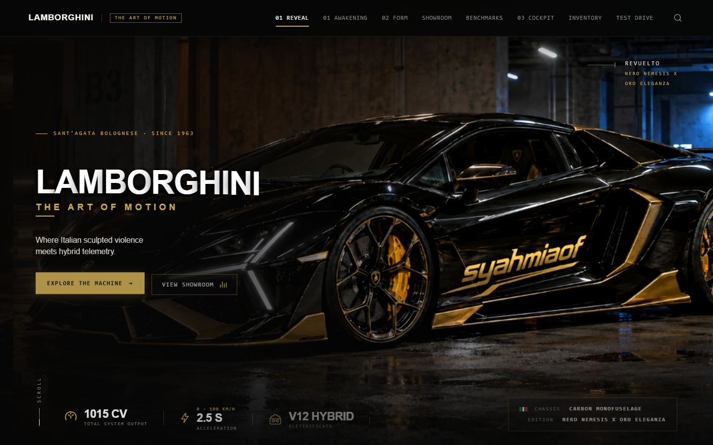

<div align="center">
  <h1>LAMBORGHINI — THE ART OF MOTION</h1>
  <p><strong>Cinematic automotive scrollytelling web experience with deterministic Canvas 2D image sequence playback.</strong></p>
  <p>
    <a href="https://lamborghini.syahmiaof.my"></a>
    <a href="https://github.com/syahmiaof/lamborghini-art-of-motion"></a>
    <a href="LICENSE"></a>
    <a href="https://syahmiaof.my"></a>
  </p>

  

  <br/><br/>

  <p><strong>Independent automotive concept study inspired by the Revuelto, Temerario, and Urus SE. High-fidelity scrollytelling, Canvas 2D frame-scrubbing, and Chiaroscuro visual art direction.</strong></p>

  <p><a href="https://lamborghini.syahmiaof.my">Live Cinematic Experience</a> • <a href="#-project-overview">Overview</a> • <a href="#-narrative--motion-architecture">Chapters</a> • <a href="#-tech-stack">Tech Stack</a> • <a href="#-engineering-notes--performance">Engineering</a></p>
</div>

---

## 💎 Project Overview

- **Functionality**: High-performance scrollytelling interface orchestrating 360+ WebP frame sequences across 8 semantic chapters with Canvas 2D rendering and bounded LRU memory management (<15 MB footprint).
- **Aesthetic Value**: Sant'Agata Bolognese automotive typography, Chiaroscuro high-contrast lighting, and buttery smooth 60fps Lenis scroll interpolation.
- **Business Value**: Exhibits luxury brand digital craftsmanship, zero-layout-shift responsive performance, and deterministic frame scrubbing bypassing mobile video autoplay restrictions.

---

## 🏎️ Narrative & Motion Architecture

```text
User Scroll (Lenis Engine) → GSAP ScrollTrigger (Normalized Progress 0.0–1.0) → FrameLoader (Off-thread ImageBitmap + LRU Cache) → Canvas 2D Viewport Fill → Choreographed Typography & Telemetry Beats
```

The website unfolds across 8 semantic chapters:

- **01 / Hero (`#hero`)** — Editorial entrance featuring the customized Revuelto *Nero Nemesis X Oro Eleganza* (`syahmiaof` decal), real-time hybrid telemetry infographic strip, and Sant'Agata Bolognese typography.
- **02 / The Awakening (`#awakening`)** — Scroll-driven underground garage reveal (121 WebP frames) transitioning from dark silhouette to piercing hexagonal Y-optics illumination.
- **03 / The Golden Reveal / Form (`#presence`)** — Exterior camera sweep (121 WebP frames) tracing the gold-finished wheels, angular aerodynamic air-intakes, and side profile livery.
- **04 / Model Showroom (`#showroom`)** — Pinned horizontal showcase exploring the hybrid lineup: Revuelto (1,015 CV), Temerario (920 CV), and Urus SE (800 CV).
- **05 / Dynamic Benchmarks (`#benchmarks`)** — Interactive telemetry progress bars measuring horsepower, lateral acceleration, aerodynamic downforce, and monofuselage torsional rigidity.
- **06 / The Cockpit (`#gallery` / `#cockpit`)** — Interior push-in Canvas sequence (121 WebP frames) exploring the carbon monofuselage cabin, digital instrument cluster, and driver-centric controls.
- **07 / Available Inventory (`#inventory`)** — Tag-filtered catalog cards with instant modal specs and chassis inspection.
- **08 / Experience Reservation (`#experience`)** — Client test drive request module with reactive form validation and telemetry feedback.

---

## 🛠️ Tech Stack

<p align="center">
  
  
  
  
  
  
  
  
  
</p>

---

## 🔍 Quality & Automated Verification

The automated verification pipeline tests:
- **5 Responsive Viewports**: Desktop (1440×900), Ultrawide (1920×1080), Tablet (768×1024), Mobile (390×844), and Short (1280×560).
- **Layout Integrity**: Zero horizontal layout overflow across all pinned scroll stages.
- **Canvas 2D Scrubbing**: Frame-scrubbing continuity with bidirectional forward/backward scrubbing.
- **Accessibility**: OS `prefers-reduced-motion: reduce` graceful degradation.

---

## 🌐 Production Deployment

- **Custom Domain:** [lamborghini.syahmiaof.my](https://lamborghini.syahmiaof.my)
- **Vercel Production:** [lamborghini-art-of-motion.vercel.app](https://lamborghini-art-of-motion.vercel.app)
- **Edge Routing:** Cloudflare Edge Worker & DNS

---

## ⚙️ Engineering Notes & Performance

- **Canvas 2D Frame Scrubbing vs Autoplay Video:** Video-to-image sequences bypass HTML5 video autoplay limitations, ensuring deterministic scrubbing, instantaneous reverse scroll, and zero mobile playback blocking.
- **Bounded Memory:** `FrameLoader` maintains an LRU memory capacity limited to 10 frames with directional preloading, keeping memory footprint under ~15 MB and avoiding garbage collection stutter.
- **Chiaroscuro Art Direction:** Preserves dark industrial garage contrast while maintaining crisp vehicle legibility and clear typography.
- **Independent Study:** This project is an independent creative development portfolio piece. It is not affiliated with, endorsed by, or sponsored by Automobili Lamborghini S.p.A.

---

## 👑 Builder

**Muhammad Syahmi**  
- Portfolio: [syahmiaof.my](https://syahmiaof.my)  
- GitHub: [@syahmiaof](https://github.com/syahmiaof)  
- Live Project: [lamborghini.syahmiaof.my](https://lamborghini.syahmiaof.my)
