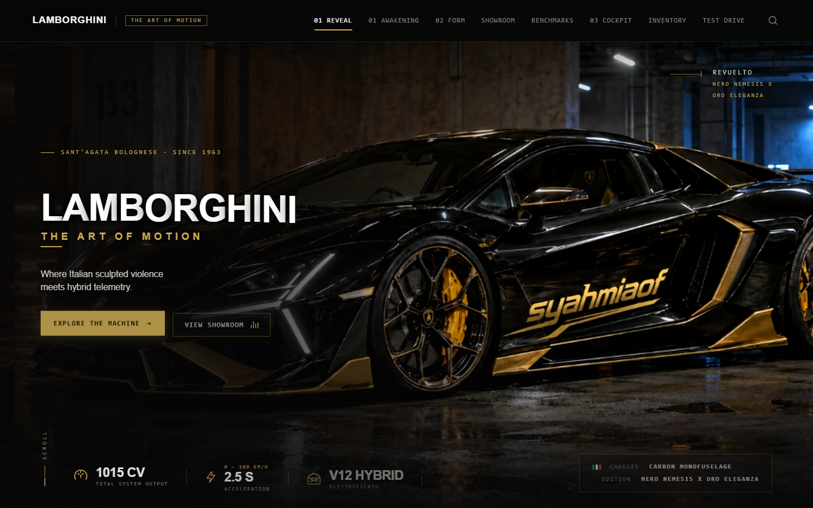

  <h1>LAMBORGHINI — THE ART OF MOTION</h1>
  
<strong>Cinematic automotive scrollytelling web experience with deterministic Canvas 2D image sequence playback.</strong>

  

    <a href="https://lamborghini.syahmiaof.my">Live experience</a> · 
    <a href="https://syahmiaof.my">Portfolio</a> · 
    <a href="https://lamborghini-art-of-motion.vercel.app">Vercel mirror</a>
  

> Independent automotive concept study. Inspired by the Lamborghini Revuelto, Temerario, and Urus SE. Developed as a creative engineering exploration in high-fidelity scrollytelling, Canvas 2D frame-scrubbing, and Chiaroscuro visual art direction. Not affiliated with Automobili Lamborghini S.p.A.

## Narrative & Motion Architecture

~~~text
User Scroll (Lenis Engine) → GSAP ScrollTrigger (Normalized Progress 0.0–1.0) → FrameLoader (Off-thread ImageBitmap + LRU Cache) → Canvas 2D Viewport Fill → Choreographed Typography & Telemetry Beats
~~~

The website unfolds across 8 semantic chapters:

- **01 / Hero (`#hero`)** — Editorial entrance featuring the customized Revuelto *Nero Nemesis X Oro Eleganza* (`syahmiaof` decal), real-time hybrid telemetry infographic strip, and Sant'Agata Bolognese typography.
- **02 / The Awakening (`#awakening`)** — Scroll-driven underground garage reveal (121 WebP frames) transitioning from dark silhouette to piercing hexagonal Y-optics illumination.
- **03 / The Golden Reveal / Form (`#presence`)** — Exterior camera sweep (121 WebP frames) tracing the gold-finished wheels, angular aerodynamic air-intakes, and side profile livery.
- **04 / Model Showroom (`#showroom`)** — Pinned horizontal showcase exploring the hybrid lineup: Revuelto (1,015 CV), Temerario (920 CV), and Urus SE (800 CV).
- **05 / Dynamic Benchmarks (`#benchmarks`)** — Interactive telemetry progress bars measuring horsepower, lateral acceleration, aerodynamic downforce, and monofuselage torsional rigidity.
- **06 / The Cockpit (`#gallery` / `#cockpit`)** — Interior push-in Canvas sequence (121 WebP frames) exploring the carbon monofuselage cabin, digital instrument cluster, and driver-centric controls.
- **07 / Available Inventory (`#inventory`)** — Tag-filtered catalog cards with instant modal specs and chassis inspection.
- **08 / Experience Reservation (`#experience`)** — Client test drive request module with reactive form validation and telemetry feedback.

## Stack

| Layer | Technology |
|---|---|
| Interface & Architecture | React 19, TypeScript, Vite |
| Motion & Scrollytelling | GSAP 3, ScrollTrigger, Lenis Smooth Scroll |
| Rendering Engine | HTML5 Canvas 2D, Bounded LRU Cache, Off-thread `createImageBitmap` |
| Asset Pipeline | WebP frame sequences (1080p source @ 24fps), Chiaroscuro grade |
| Styling | Pure CSS3, Custom tokens, Chiaroscuro grading, Responsive `clamp()` |
| Delivery & CDN | GitHub, Vercel Production, Cloudflare Edge Worker & DNS |

## Run

~~~bash
npm install
npm run dev
npm run typecheck
npm run lint
npm test
npm run build
~~~

## Browser QA

~~~bash
npm run qa
~~~

The automated Playwright test suite verifies:
- 5 responsive viewports: Desktop (1440×900), Ultrawide (1920×1080), Tablet (768×1024), Mobile (390×844), and Short (1280×560).
- Zero horizontal layout overflow across all pinned scroll stages.
- Canvas 2D frame-scrubbing continuity with bidirectional forward/backward scrubbing.
- Strict accessibility compliance including OS `prefers-reduced-motion: reduce` graceful degradation.

## Deployment

- **Custom Domain:** [lamborghini.syahmiaof.my](https://lamborghini.syahmiaof.my)
- **Vercel Production:** [lamborghini-art-of-motion.vercel.app](https://lamborghini-art-of-motion.vercel.app)
- **Edge Routing:** Cloudflare Edge Worker (`lamborghini-art-of-motion`)

Vercel automatically deploys the `main` branch. Raw 1080p source clips and QA artifacts stay outside the production bundle.

## Engineering Notes & Limits

- **Canvas 2D Frame Scrubbing vs Autoplay Video:** Video-to-image sequences bypass HTML5 video autoplay limitations, ensuring deterministic scrubbing, instantaneous reverse scroll, and zero mobile playback blocking.
- **Bounded Memory:** `FrameLoader` maintains an LRU memory capacity limited to 10 frames with directional preloading, keeping memory footprint under ~15 MB and avoiding garbage collection stutter.
- **Chiaroscuro Art Direction:** Preserves dark industrial garage contrast while maintaining crisp vehicle legibility and clear typography.
- **Independent Study:** This project is an independent creative development portfolio piece. It is not affiliated with, endorsed by, or sponsored by Automobili Lamborghini S.p.A.

## Builder

[Muhammad Syahmi](https://syahmiaof.my) · [GitHub](https://github.com/syahmiaof) · [Email](mailto:syahmiaof123@gmail.com)
